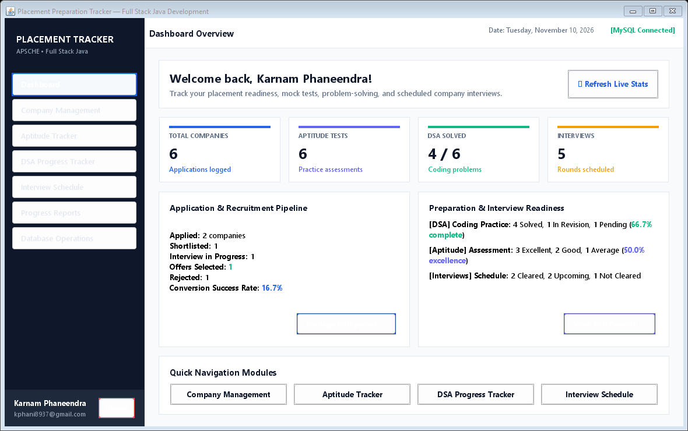
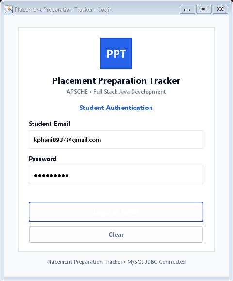
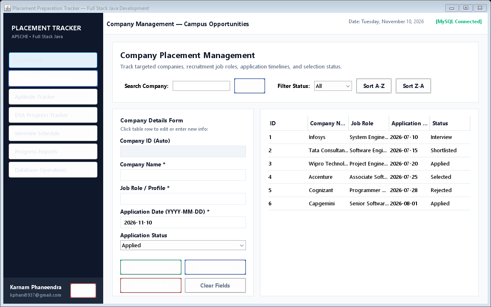
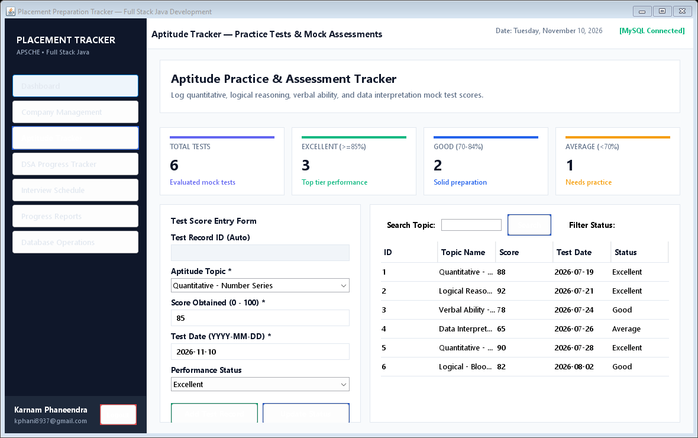
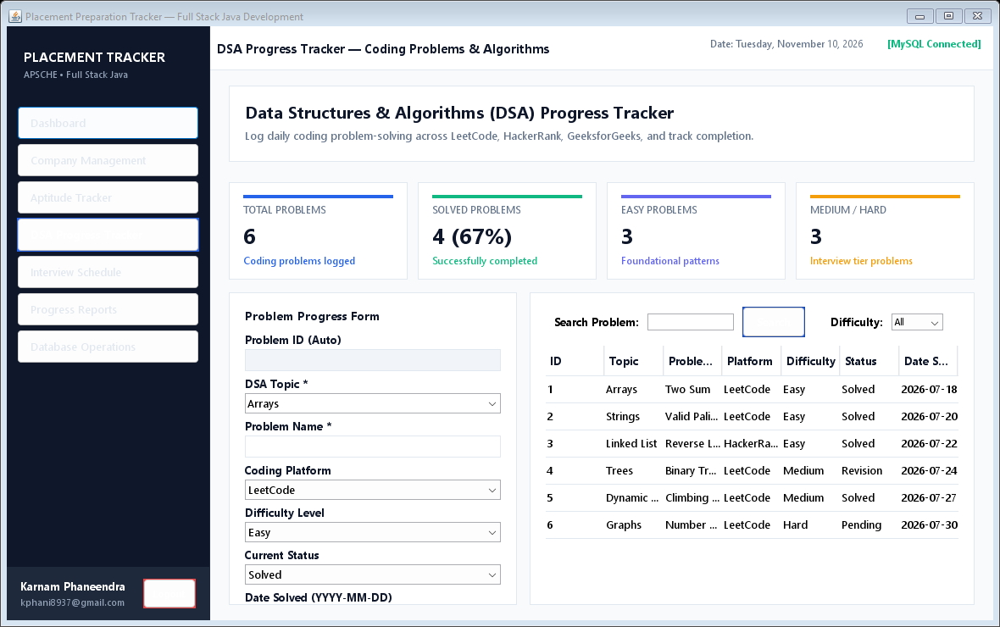
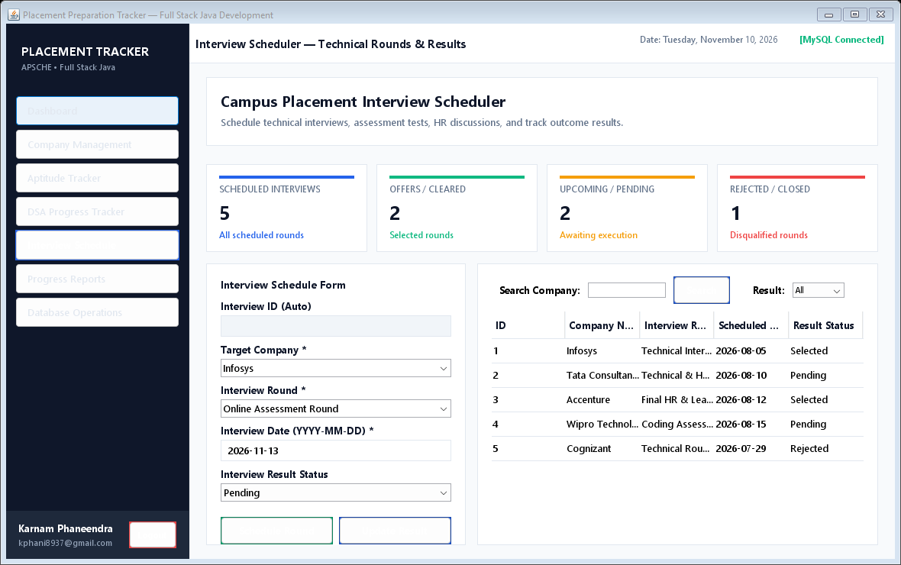
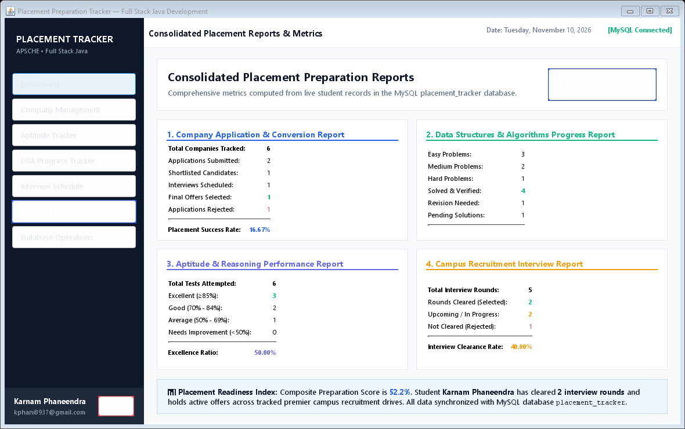
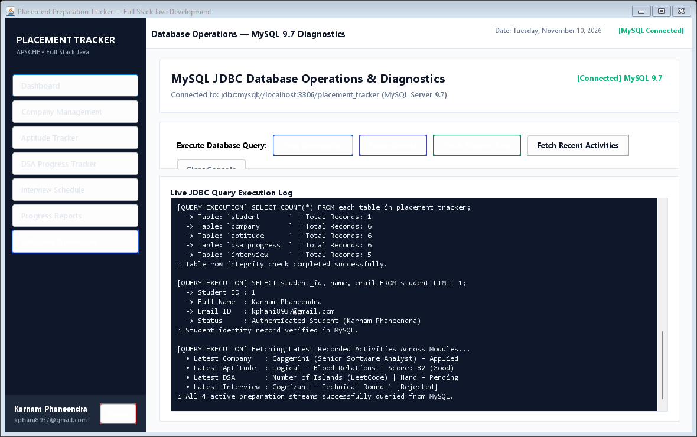

<div align="center">

# Placement Preparation Tracker

### A Full-Stack Java Desktop + Web Application for Campus Placement Management

[](https://www.java.com/)
[](https://www.mysql.com/)
[](https://dev.mysql.com/downloads/connector/j/)
[](https://docs.oracle.com/javase/8/docs/technotes/guides/swing/)
[](LICENSE)
[](https://sche.ap.gov.in/)

<br/>

**APSCHE Internship Project** | ExcelR EdTech Pvt. Ltd. | Full Stack Java Development  
**Student:** Karnam Phaneendra &nbsp;|&nbsp; **PIN:** 24A85A6102 &nbsp;|&nbsp; **College:** Sri Vasavi Engineering College

<br/>



</div>

---

## What is Placement Preparation Tracker?

**Placement Preparation Tracker** is a comprehensive Java-based application that centralizes all student placement preparation activities into a single, organized platform. Built with a **dual-interface architecture** — a professional **Java Swing desktop GUI** and an embedded **localhost web portal** — it connects to a **MySQL 9.7 relational database** via **JDBC PreparedStatements** for secure, real-time data persistence.

The application helps engineering students systematically track companies they target, monitor aptitude test performance, log DSA problem-solving progress, schedule interview rounds, and generate consolidated placement readiness reports — all from one dashboard.

> **APSCHE Internship Deliverable** — This project was developed as the capstone deliverable for the APSCHE Full Stack Java Development internship program conducted in collaboration with ExcelR EdTech Pvt. Ltd. The complete 31-page internship report is included in this repository.

---

## Screenshots

<table>
  <tr>
    <td align="center"><br/><sub><b>Student Login</b></sub></td>
    <td align="center"><br/><sub><b>Dashboard</b></sub></td>
  </tr>
  <tr>
    <td align="center"><br/><sub><b>Company Management</b></sub></td>
    <td align="center"><br/><sub><b>Aptitude Tracker</b></sub></td>
  </tr>
  <tr>
    <td align="center"><br/><sub><b>DSA Progress Tracker</b></sub></td>
    <td align="center"><br/><sub><b>Interview Schedule</b></sub></td>
  </tr>
  <tr>
    <td align="center"><br/><sub><b>Progress Reports</b></sub></td>
    <td align="center"><br/><sub><b>Database Operations Console</b></sub></td>
  </tr>
</table>

---

## Key Features

| Module | Features |
|--------|----------|
| **Student Login** | Secure credential verification via JDBC PreparedStatement against MySQL `student` table |
| **Company Management** | Full CRUD — Add, View, Update status, Delete, and Search companies; pipeline statuses: *Applied → Shortlisted → Interview → Selected/Rejected* |
| **Aptitude Tracker** | Log mock test scores by topic (Quant, Logical, Verbal, DI); auto-grading: *Excellent / Good / Average / Needs Improvement* |
| **DSA Progress Tracker** | Track coding problems by topic, difficulty (*Easy / Medium / Hard*), platform (LeetCode, HackerRank, GFG), and completion status |
| **Interview Schedule** | Manage all interview rounds (*Online Assessment, Technical, HR*) with dates, outcomes, and company linkage |
| **Progress Reports** | Composite **Placement Readiness Index** — weighted aggregation of company pipeline, aptitude percentile, DSA completion, and interview conversion rate |
| **Database Console** | Live JDBC diagnostics — table row counts, connection latency, SQL health checks, and activity logs |
| **Localhost Web Portal** | Embedded Java HTTP server on port 8080; HTML5 Single-Page Application with full REST API — no separate web framework needed |

---

## Architecture

```
┌─────────────────────────────────────────────────────────┐
│               Placement Preparation Tracker             │
├──────────────────────┬──────────────────────────────────┤
│   Desktop GUI        │   Localhost Web Portal           │
│   (Java Swing)       │   (Embedded HTTP Server :8080)   │
│   LoginFrame.java    │   WebServer.java                 │
│   MainFrame.java     │   HTML5 SPA + REST JSON API      │
│   *Panel.java        │   /api/dashboard, /api/companies │
└──────────┬───────────┴────────────────┬─────────────────┘
           │  Service Layer             │
           │  LoginService / Company    │
           │  Aptitude / DSA / Interview│
           └────────────┬──────────────┘
                        │  DAO Layer (JDBC PreparedStatements)
                        │  StudentDAO / CompanyDAO
                        │  AptitudeDAO / DSAProgressDAO / InterviewDAO
                        └──────────────┬──────────────────
                                       │
                        ┌──────────────▼──────────────────┐
                        │  MySQL 9.7  — placement_tracker  │
                        │  student | company | aptitude    │
                        │  dsa_progress | interview        │
                        └─────────────────────────────────┘
```

---

## Technology Stack

| Layer | Technology | Version |
|-------|-----------|---------|
| Language | Java SE | JDK 1.8.0 (Java 8+) |
| Desktop GUI | Java Swing (`javax.swing`, `java.awt`) | Built-in JDK |
| Web Server | `com.sun.net.httpserver.HttpServer` | Built-in JDK |
| Database | MySQL Server | 9.7 (localhost:3306) |
| DB Connectivity | JDBC with MySQL Connector/J | 9.0.0 |
| Architecture | Multi-Tier (Presentation → Service → DAO → DB) | — |
| DB Schema | 5 relational tables, normalized with FK constraints | — |
| Report Engine | Composite Placement Readiness Index algorithm | Custom |

---

## Project Structure

```
PlacementPreparationTracker/
│
├── src/com/placementtracker/
│   ├── database/
│   │   ├── DBConnection.java          # Centralized JDBC connection manager
│   │   └── TestConnection.java        # Standalone connectivity verification
│   ├── model/
│   │   ├── Student.java               # Student entity
│   │   ├── Company.java               # Company application entity
│   │   ├── Aptitude.java              # Aptitude assessment entity
│   │   ├── DSAProgress.java           # Coding problem entity
│   │   ├── Interview.java             # Interview schedule entity
│   │   ├── Report.java                # Company funnel analytics DTO
│   │   ├── DSAReport.java             # DSA completion analytics DTO
│   │   ├── AptitudeReport.java        # Aptitude performance DTO
│   │   └── InterviewReport.java       # Interview clearance DTO
│   ├── dao/
│   │   ├── StudentDAO.java            # PreparedStatements for student auth
│   │   ├── CompanyDAO.java            # Company CRUD operations
│   │   ├── AptitudeDAO.java           # Aptitude record operations
│   │   ├── DSAProgressDAO.java        # DSA problem tracking operations
│   │   └── InterviewDAO.java          # Interview schedule operations
│   ├── service/
│   │   ├── LoginService.java          # Authentication business logic
│   │   ├── CompanyService.java        # Company management service
│   │   ├── AptitudeService.java       # Aptitude scoring & reporting
│   │   ├── DSAProgressService.java    # DSA progress analytics
│   │   └── InterviewService.java      # Interview scheduling service
│   ├── gui/                           # Java Swing UI panels
│   │   ├── LoginFrame.java            # Login window
│   │   ├── MainFrame.java             # Main window with sidebar navigation
│   │   ├── DashboardPanel.java        # KPI dashboard
│   │   ├── CompanyPanel.java          # Company management panel
│   │   ├── AptitudePanel.java         # Aptitude tracker panel
│   │   ├── DSAPanel.java              # DSA progress panel
│   │   ├── InterviewPanel.java        # Interview schedule panel
│   │   ├── ReportsPanel.java          # Progress reports panel
│   │   ├── DatabaseOperationsPanel.java # DB diagnostics panel
│   │   └── UITheme.java               # Custom modern color theme
│   ├── web/
│   │   └── WebServer.java             # Embedded HTTP server + HTML5 SPA + REST API
│   ├── validation/
│   │   └── InputValidator.java        # Input sanitization & validation
│   └── util/
│       ├── Main.java                  # Application entry point
│       ├── ConsoleUI.java             # Legacy terminal menu
│       └── ScreenshotCapturer.java    # Automated screenshot capture utility
│
├── screenshots/                       # Genuine application output screenshots
│   ├── 01_login.png
│   ├── 02_dashboard.png
│   ├── 03_company_management.png
│   ├── 04_aptitude_tracker.png
│   ├── 05_dsa_progress.png
│   ├── 06_interview_schedule.png
│   ├── 07_progress_reports.png
│   ├── 08_database_operations.png
│   ├── arch_diagram.png
│   └── er_diagram.png
│
├── placement_tracker_setup.sql        # MySQL schema + sample seed data
├── run_desktop_gui.bat                # One-click desktop GUI launcher
├── run_localhost_server.bat           # One-click web server launcher
├── TESTING_REPORT.md                  # 12-module functional test results
├── Karnam_Phaneendra_APSCHE_Internship_Report.docx  # Full 31-page report
├── Karnam_Phaneendra_APSCHE_Internship_Report.pdf   # PDF export
└── README.md
```

---

## Getting Started

### Prerequisites

| Requirement | Version | Notes |
|-------------|---------|-------|
| Java JDK | 8+ (1.8.0+) | Download from [oracle.com](https://www.oracle.com/java/technologies/downloads/) |
| MySQL Server | 8.x or 9.x | Running on `localhost:3306` |
| MySQL Connector/J | 9.0.0 | JDBC driver JAR — place it in `lib/` or update classpaths in batch files |

### Step 1 — Set Up the MySQL Database

```sql
-- Run the provided SQL script in MySQL Workbench or MySQL CLI:
SOURCE placement_tracker_setup.sql;
```

This creates the `placement_tracker` database with five tables and inserts sample data.

### Step 2 — Default Login Credentials

```
Email:    kphani8937@gmail.com
Password: Phani@123
```

### Step 3 — Compile the Project

Open PowerShell in the project root and run:

```powershell
# Replace the JAR path below with your actual MySQL Connector/J path
$JAR = "path\to\mysql-connector-j-9.0.0.jar"

javac -encoding UTF-8 `
      -cp "$JAR;src" `
      -d bin `
      (Get-ChildItem -Path src -Filter "*.java" -Recurse | Select-Object -ExpandProperty FullName)
```

### Step 4A — Run the Desktop GUI (Java Swing)

```powershell
.\run_desktop_gui.bat
# or:
java -cp "$JAR;bin" com.placementtracker.util.Main
```

### Step 4B — Run the Localhost Web Portal (Browser)

```powershell
.\run_localhost_server.bat
# or:
java -cp "$JAR;bin" com.placementtracker.web.WebServer 8080
```

Then open your browser and visit: **`http://localhost:8080/`**

### REST API Endpoints

| Method | Endpoint | Description |
|--------|----------|-------------|
| GET | `/` | HTML5 Single-Page Application |
| GET | `/api/status` | Server health check |
| GET | `/api/dashboard` | Aggregated KPI metrics (JSON) |
| POST | `/api/login` | Student authentication |
| GET/POST | `/api/companies` | Company list / Add company |
| GET/POST | `/api/aptitude` | Aptitude records / Add record |
| GET/POST | `/api/dsa` | DSA progress / Add problem |
| GET/POST | `/api/interviews` | Interview schedule / Add interview |

---

## Database Schema

```sql
-- student
CREATE TABLE student (
    id INT AUTO_INCREMENT PRIMARY KEY,
    name VARCHAR(100) NOT NULL,
    email VARCHAR(100) UNIQUE NOT NULL,
    password VARCHAR(100) NOT NULL,
    college VARCHAR(150),
    branch VARCHAR(50),
    cgpa DECIMAL(3,2)
);

-- company
CREATE TABLE company (
    id INT AUTO_INCREMENT PRIMARY KEY,
    student_id INT,
    company_name VARCHAR(100) NOT NULL,
    job_role VARCHAR(100),
    package_lpa DECIMAL(5,2),
    application_date DATE,
    status VARCHAR(30) DEFAULT 'Applied',    -- Applied/Shortlisted/Interview/Selected/Rejected
    FOREIGN KEY (student_id) REFERENCES student(id)
);

-- aptitude
CREATE TABLE aptitude (
    id INT AUTO_INCREMENT PRIMARY KEY,
    student_id INT,
    topic VARCHAR(100),
    score INT,
    total_questions INT,
    test_date DATE,
    FOREIGN KEY (student_id) REFERENCES student(id)
);

-- dsa_progress
CREATE TABLE dsa_progress (
    id INT AUTO_INCREMENT PRIMARY KEY,
    student_id INT,
    problem_name VARCHAR(150),
    topic VARCHAR(100),
    difficulty VARCHAR(10),               -- Easy/Medium/Hard
    platform VARCHAR(50),
    status VARCHAR(20) DEFAULT 'Pending', -- Pending/Solved/Revisit
    solved_date DATE,
    FOREIGN KEY (student_id) REFERENCES student(id)
);

-- interview
CREATE TABLE interview (
    id INT AUTO_INCREMENT PRIMARY KEY,
    student_id INT,
    company_name VARCHAR(100),
    round_type VARCHAR(50),               -- Online Assessment/Technical/HR
    interview_date DATE,
    outcome VARCHAR(20) DEFAULT 'Pending',-- Selected/Pending/Rejected
    notes TEXT,
    FOREIGN KEY (student_id) REFERENCES student(id)
);
```

---

## Functional Test Results

| # | Module | Test Case | Result |
|---|--------|-----------|--------|
| 1 | Startup | Application launches with no exceptions | ✅ PASS |
| 2 | Login | Valid credentials authenticate successfully | ✅ PASS |
| 3 | Login | Invalid credentials show appropriate error | ✅ PASS |
| 4 | Dashboard | KPI cards load live data from MySQL | ✅ PASS |
| 5 | Company | Add new company record and persist to DB | ✅ PASS |
| 6 | Company | View, search, sort company table | ✅ PASS |
| 7 | Company | Update status and delete company record | ✅ PASS |
| 8 | Aptitude | Add aptitude score with auto-grading | ✅ PASS |
| 9 | DSA | Record problem with topic, difficulty, platform | ✅ PASS |
| 10 | Interview | Schedule interview round and store outcome | ✅ PASS |
| 11 | Reports | Consolidated readiness index calculates correctly | ✅ PASS |
| 12 | Persistence | Data survives application restart (DB verified) | ✅ PASS |

**12 / 12 test cases passed.**

---

## Internship Documentation

This project was submitted as a complete APSCHE internship deliverable:

| Document | Description |
|----------|-------------|
| [`Karnam_Phaneendra_APSCHE_Internship_Report.docx`](Karnam_Phaneendra_APSCHE_Internship_Report.docx) | Full 31-page internship report (Word) |
| [`Karnam_Phaneendra_APSCHE_Internship_Report.pdf`](Karnam_Phaneendra_APSCHE_Internship_Report.pdf) | PDF export for submission |
| [`TESTING_REPORT.md`](TESTING_REPORT.md) | Detailed functional test documentation |
| [`placement_tracker_setup.sql`](placement_tracker_setup.sql) | MySQL schema and seed data |

**Report chapters:**
- Chapter 6 — Project Introduction & Objectives  
- Chapter 7 — System Analysis & Design (Architecture + ER Diagram)  
- Chapter 8 — System Development (Structure, Modules, Technologies)  
- Chapter 9 — Implementation (JDBC, Auth, CRUD, Validation, Reports)  
- Chapter 10 — Results & Conclusion (12 test cases, 8 application screenshots)

---

## About the Developer

| Field | Detail |
|-------|--------|
| **Name** | Karnam Phaneendra |
| **Student PIN** | 24A85A6102 |
| **Email** | kphani8937@gmail.com |
| **College** | Sri Vasavi Engineering College |
| **Program** | APSCHE Internship — Full Stack Java Development |
| **Organization** | ExcelR EdTech Pvt. Ltd. in collaboration with APSCHE |

---

## License

This project is licensed under the **MIT License** — see the [LICENSE](LICENSE) file for details.

---

<div align="center">

**Placement Preparation Tracker** — Bridging preparation and placement, one record at a time.

Made with Java ☕ | MySQL | JDBC | Swing

</div>
